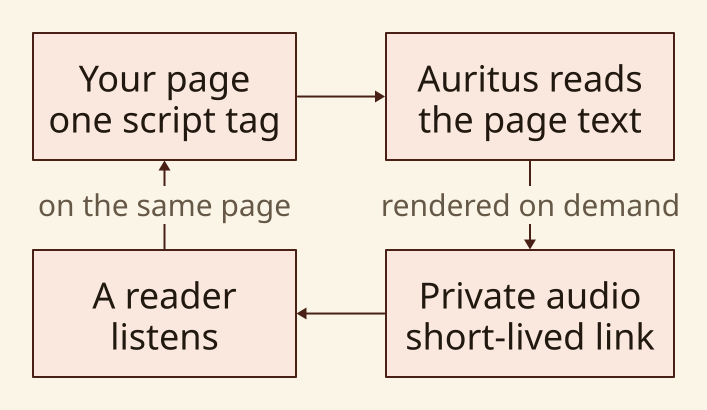
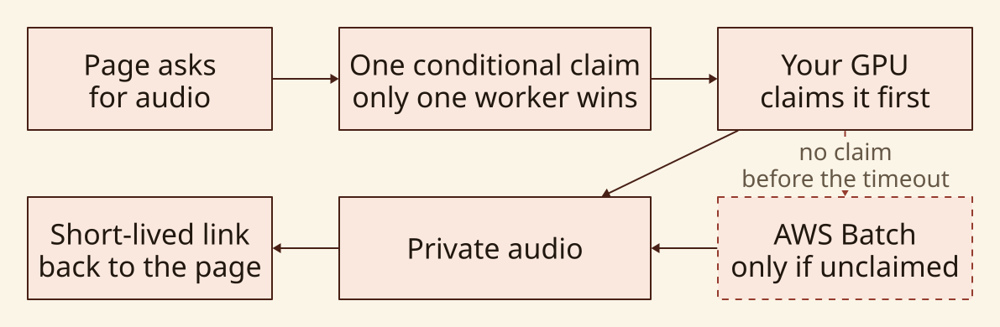
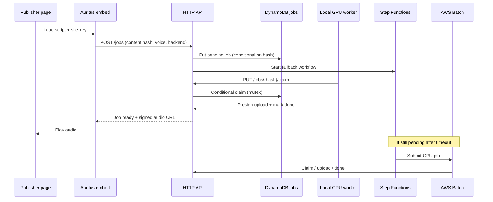
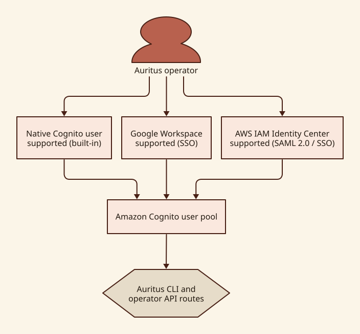

# Auritus architecture

Auritus is a just-in-time TTS pipeline: the browser embed hashes page content,
the API stores jobs behind a mutex, operators' local GPU workers race to claim
work, and AWS Batch runs only when nobody claims in time.

## Why this architecture

Auritus keeps the three choices that a hosted TTS product usually makes for you
in the operator's hands:

- **Data location:** page text is handled by the infrastructure you operate.
  The generated audio is private by default.
- **Model choice:** the worker backend is pluggable, so a team can choose an
  open model and tune its quality, voice, and cost tradeoffs.
- **Compute cost and resilience:** a worker on your own GPU can synthesize the
  routine work. AWS Batch is available when local hardware does not claim the
  job in time.

## AWS deployment

The local worker and the Batch worker use the same job-claim rules. That means
the cloud path does not duplicate work simply because a local GPU is slow: only
the worker that wins the conditional claim may complete the job.

## Components

| Layer | Responsibility |
| --- | --- |
| `embed/` | DOM extraction, ignore rules, content hash, player UI |
| API (Lambda router) | Job CRUD, site keys, quotas, presigned audio URLs |
| DynamoDB | Job mutex state, site registry |
| Local worker (`auritus worker`) | Claim, synthesize, upload audio |
| Step Functions + Batch | Wait for local claim window, then GPU fallback |
| Cognito | Operator CLI authentication (password auth; optional Google IdP) |
| S3 + CloudFront | Private audio objects, short-lived signed playback URLs |

## Request flow

## DynamoDB job mutex

- Partition key: `content_hash` (deduplication).
- Status lifecycle: `pending` → `claimed` → `done` (or error paths).
- Claim uses a conditional update: a job is taken only when it is `pending`
  or its previous claim has expired. The response carries a fencing token.
- A claim lasts one window (`claim_seconds`, default 15 minutes, at most one
  hour). The holder renews it with `PUT /jobs/{hash}/claim` and
  `{"renew": true, "claim_token": ...}` while it works; a renewal succeeds only
  for the current token.
- Uploading audio and recording a result or a failure must present the token.
  A write from any other token (a worker whose claim lapsed and was taken, or
  whose claim an operator released) is refused with `409 stale_claim`.
- GSI on `status` + `created_at` supports worker polling (`/jobs/claimable`).

## Local worker race vs Batch fallback

- When a job is created, Step Functions waits `FALLBACK_SECONDS` (default 15
  minutes).
- After the wait, the state machine calls the fallback gate. The gate makes one
  conditional write that succeeds only if this timer still belongs to the job's
  current attempt and the job is `pending` or its claim has expired. A live
  claim always wins: the timer waits until the claim's deadline and asks again.
- Only a successful write leads to an AWS Batch submission, and the Batch job
  receives the fencing token the gate obtained. A job that is done, failed,
  requeued or deleted ends the timer without starting compute, and so does a
  gate that cannot answer.
- Arming the same attempt twice does not start a second timer; requeueing a job
  issues a new attempt, so a timer from before a requeue starts nothing.
- Daily site quotas count per UTC day and start again at one each day. The
  quota is taken by a conditional increment (`daily_usage < quota`) before the
  job is written, so concurrent creates cannot exceed it; a job whose timer
  cannot be started is taken back and its reservation released.
- A timer execution that fails or times out raises a CloudWatch alarm (sent to
  the budget topic).
- A Batch worker whose renewal is refused (401, 403 or 409) ends its process at
  once so the GPU stops. Known limit: an upload URL already issued to a worker
  stays usable until it expires (5 minutes), so a worker that lost its claim in
  that window could still overwrite the audio object; it can never record a
  result.

### Deploy order for claim fencing

1. Push the new worker image (it sends and renews the claim token) **before**
   deploying the stack, so no Batch job starts with an old image against the new
   router.
2. Deploy when the job queue is idle (no claimed jobs, no running Batch jobs):
   claims taken before the deploy have no token and finish only through the
   tokenless path.
3. Upgrade every CLI/worker to this version; an older worker ignores the claim
   token and its upload, result and failure calls are refused with 409.

## Job kinds: speech and video

The job table holds two kinds of job with one claim lifecycle. A job with no
`kind` is a speech job.

- **Speech** jobs are created with a site key, counted against its daily quota,
  and have a cloud fallback.
- **Video** jobs are created by an operator (`kind: "video"` with `script`,
  optional `timeline`, `audio_sha256` and `options`). Their hash covers the
  script, timeline, narration audio and the options that change the picture, so
  equal inputs share one job (a conditional write). Narration audio goes in the
  content store (`POST /store/{sha256}/presign-upload`) before a job may refer
  to it. They cost the cloud nothing, need no quota, and get **no fallback
  timer**: cloud rendering is not enabled for video, so a video job waits, with
  `waiting_reason: waiting_for_local_worker`, until a `babulus worker` claims
  it. The fallback gate also refuses any job that is not a speech job.

`babulus worker` claims both kinds. It runs a video job by starting the
repository's TypeScript render entry point (`scripts/render-video-from-script.ts`)
as a subprocess and reports progress while it runs. A machine without Node, the
toolchain's packages, Chromium or ffmpeg is told which is missing and how to fix
it (`babulus video check`), and leaves video jobs waiting.

## Named (cloned) voices

A cloned voice is a recording and its transcript. `babulus voice publish
<voice> --voices-dir <folder>` uploads both to the content store (objects keyed
by SHA-256), then a manifest that names them, and only then calls
`POST /voices/{voice}/publish`. Publishing checks that the manifest is exactly
the object its hash names, describes this voice, and that every file it lists is
in the store; anything missing is refused by name, so a voice is never half
published. Jobs for a published voice carry its manifest, and a Batch worker
downloads the files from the redeem response, verifies each hash, and passes the
folder to the backend. A named voice that cannot be found, or that a backend
cannot speak at all (Higgs and Bark have only their default voice), fails the
job with `VoiceNotFound`; it is never spoken in a stock voice. Local workers
read their own voices folder.

## Site keys and embed auth

- Publisher-origin registration and enforcement are planned secure-by-design
  work; the current site-creation path does not persist an origin binding.
- The embed sends `X-Auritus-Site-Key` on job and playback requests.
- The router currently validates the key against the `AuritusSites` table and
  enforces quotas. Runtime origin registration and enforcement are planned work,
  not completed controls. Site keys are not Cognito JWTs; they are deployer-
  issued capabilities.

## Operator identity choices

- **Native Cognito user — supported (built-in):** CDK provisions a user pool and app
  client. `auritus login --username <email>` uses the native pool's
  `USER_PASSWORD_AUTH` flow. Ideal when you want to keep everything self-contained
  inside your AWS account.
- **Google Workspace via Cognito — supported (SSO):** the stack configures Google
  OIDC federation on the user pool. Operators authenticate via Google single sign-on
  in the web console or via `auritus login --sso google`.
- **AWS IAM Identity Center (AWS SSO) — supported (SAML 2.0 / SSO):** the user pool
  supports SAML 2.0 federation with AWS IAM Identity Center or corporate identity
  providers (Okta, Entra ID, Ping). Operators sign in via single sign-on in the web
  console or via `auritus login --sso aws-sso`.

For the supported CLI path, short-lived JWTs are stored locally under
`~/.auritus/credentials` with mode `0600`. The CLI and the web console send the
Cognito **access** token as `Authorization: Bearer <token>`.

Operator tokens are verified in two places with the same shared module
(`auritus_operator_auth`, shipped as a Lambda layer with PyJWT and
cryptography): the API Gateway Lambda authorizer on `/sites`, `/admin/*`, and
`/jobs/claimable`, and the router itself on every operator check. A token is
accepted only when its RS256 signature verifies against the user pool JWKS,
its issuer is exactly the deployed user pool, it has not expired, its
`token_use` is `access`, and its `client_id` is the CLI or web console app
client. Missing verifier configuration denies every request.

The job-mutation routes (`PUT /jobs/{hash}/claim`, `/done`, `/failed`, and
`POST /jobs/{hash}/presign-upload`) have no gateway authorizer because Batch
workers call them with a per-job token. The router accepts either that
job's token (compared in constant time) or a verified operator access token
for an operator's local worker; anything else is refused with 403. The job
token is never returned to the caller that creates the job; the Batch worker
receives it from the fallback workflow. A job token can request an upload URL
only while its job is claimed, and the token is removed when the job is marked
done or failed.

The content hash is the SHA-256 of the normalized text, the voice ID, and the
TTS backend joined by NUL characters. Normalization applies Unicode NFC,
collapses every whitespace run (including Unicode spaces) to one space, and
trims. The API computes the hash itself and rejects job creation with
`content_hash_mismatch` when a caller sends a different one, so a public site
key cannot bind its own text to another page's hash. The embed computes the
same hash with Web Crypto, which requires a secure context (HTTPS or
localhost). The rules live in one module, `auritus_content_hash` in the
operator auth Lambda layer, used by the router and the migration script.

Verification is offline, so a signed-out or disabled operator's access token
remains valid until it expires (one hour).

## Secure-by-design status

The system is intentionally structured around private audio, short-lived
delivery URLs, conditional job claims, spending limits, and verified operator
access tokens. Origin enforcement is not complete today. The full
secure-by-design architecture and control evidence are still under development.
This document describes current behavior, not a completed security assurance
package. Future security material belongs in a dedicated section that identifies
each control's threat, owner, implementation evidence, and review status.

### Planned security documentation structure

| Section | What it will establish |
| --- | --- |
| Trust boundaries | What crosses from publisher, local worker, and AWS account. |
| Identities and authorization | Operator, site-key, worker, and deployment permissions. |
| Data handling | Text, audio, metadata, retention, and deletion behavior. |
| Control evidence | CDK, tests, logging, and review evidence for each claim. |
- `auritus login --username <email>` calls Cognito `USER_PASSWORD_AUTH` and
  stores short-lived JWTs in `~/.auritus/credentials` (mode 0600).
- Operator routes (`/sites`, `/admin/*`, claimable listing) require a Cognito
  access token whose signature, issuer, expiry, `token_use`, and `client_id`
  are verified by the Lambda authorizer and again by the router.

## Audio delivery

- Generated audio lands in a private S3 bucket.
- The API returns CloudFront signed URLs (or presigned S3 URLs) scoped to the
  requesting site key and origin; objects are never world-readable by default.

## Spend guardrails

- AWS Budgets + SNS + EventBridge can disable the Batch queue when daily spend
  crosses a threshold.
- Per-site daily quotas are enforced in the router Lambda.
- `auritus killswitch disable` gives operators a manual stop.

## Related docs

- [SELF_HOSTING.md](SELF_HOSTING.md) — deploy and login on your AWS account
- [MODEL_LICENSES.md](MODEL_LICENSES.md) — TTS weight licensing notes
- [DNS.md](DNS.md) — `aurit.us` Route 53 and Amplify
